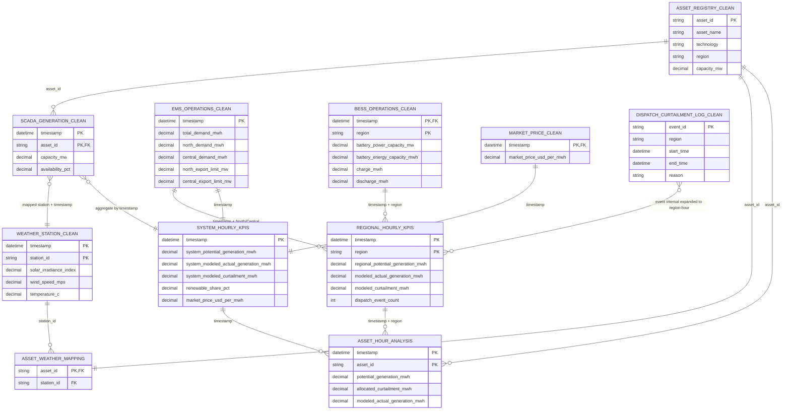

# GreenGrid v2.2 Analysis Pipeline: ERD, Joins, and Formulas

This document describes how
[`build_greengrid_analysis_table.py`](./build_greengrid_analysis_table.py)
reads the seven CSVs in `clean_data/`, models renewable generation and
curtailment, and writes the three CSVs in `analysis_output/`.

The pipeline is not a simple table append. It builds an asset-hour base,
aggregates it to region-hour grain for operational modeling, allocates modeled
curtailment back to assets, and then aggregates to system-hour grain for KPIs.
The results are **modeled estimates**, not metered actual generation or
settlement revenue.

For an asset-hour-only output, use
[`build_greengrid_asset_hour_analysis.py`](../../scripts/generate_greengrid_v2_2/build_greengrid_asset_hour_analysis.py).
It calculates and writes only asset-hour rows to
`greengrid_asset_hour_analysis_v2.csv`; it does not create separate regional
or system KPI tables or CSV outputs. The asset-hour `base` is the only
operational analysis table. Regional quantities are allocated within each
hour by asset potential-generation share, and portfolio quantities by asset
share of portfolio potential generation. If potential generation is zero for
a group, installed capacity provides the allocation weights. Hour
flags/counts are divided evenly across assets so they remain additive, while
event identifiers/reasons and market prices remain contextual asset-hour
fields. When SCADA also carries a region column, the asset registry is
authoritative; conflicts are reported as a warning.

## Entity-relationship diagram

The diagram shows logical keys and lineage. CSV files do not enforce database
foreign keys. `ASSET_WEATHER_MAPPING` is an in-memory relation constructed by
the script or read from the optional `--weather-mapping` CSV; it is not one of
the seven clean-data files.



### Grain and keys

| Entity/table | Grain (one row per...) | Logical key |
|---|---|---|
| `asset_registry_clean.csv` | Registered asset | `asset_id` |
| `scada_generation_clean.csv` | Asset and timestamp | `timestamp`, `asset_id` |
| `weather_station_clean.csv` | Weather station and timestamp | `timestamp`, `station_id` |
| Asset-weather mapping | Asset-to-station assignment | `asset_id` (exactly one mapped station per asset) |
| `ems_operations_clean.csv` | Timestamp | `timestamp` |
| `bess_operations_clean.csv` | Region and timestamp | `timestamp`, `region` |
| `market_price_clean.csv` | Timestamp | `timestamp` |
| `dispatch_curtailment_log_clean.csv` | Dispatch event | `event_id` |
| `greengrid_asset_hour_analysis.csv` | Asset and timestamp | `timestamp`, `asset_id` |
| `greengrid_regional_hourly_kpis.csv` | Region and timestamp | `timestamp`, `region` |
| `greengrid_system_hourly_kpis.csv` | Timestamp | `timestamp` |

## Join and transformation sequence

The code checks required columns, converts timestamps and numeric fields,
normalizes asset/region/station identifiers, and checks source key uniqueness
before joining. `validate=` arguments on merges assert the intended
relationships and help prevent accidental row multiplication.

### 1. Prepare the weather-to-asset mapping

- If `--weather-mapping` is supplied, the file must contain `asset_id` and
  `station_id`; duplicate pairs are removed.
- Without a mapping file, the script maps every asset to the only weather
  station if exactly one station exists. If weather contains multiple
  stations, it stops and asks for an explicit mapping rather than joining on
  timestamp alone.
- Every asset must map to exactly one known station, and every mapped asset
  and station must exist in the source data.
- Weather rows are joined to this mapping by `station_id` using an inner
  merge. The resulting rows are keyed by `timestamp` and `asset_id`.

This mapping avoids a many-to-many timestamp-only weather join, which would
multiply SCADA records when multiple stations exist.

### 2. Build the asset-hour base and attach weather

1. **SCADA to asset registry:** left join on `asset_id`
   (`many_to_one`). Each SCADA asset-hour remains in the result, with its
   descriptive fields and region from the registry. A missing registry asset
   is an error.
2. **Asset-hour to mapped weather:** left join on both `timestamp` and
   `asset_id` (`one_to_one`). Every SCADA asset-hour must have matching
   weather values; missing coverage is an error.
3. The SCADA `capacity_mw` is retained. The asset registry's `capacity_mw`
   is dropped before the join, so SCADA capacity is the capacity used in the
   model.

The resulting base has one row per SCADA asset-hour.

### 3. Derive potential generation per asset-hour

Availability is converted from percent to a fraction. For each asset-hour,
the script derives a technology-specific modeled capacity factor and computes
potential renewable energy. The formulas are specified in
[Derived fields and formulas](#derived-fields-and-formulas).

### 4. Aggregate generation and expand EMS to region-hours

- Potential generation is summed by `(timestamp, region)` to form
  `regional_potential_generation_mwh`; distinct assets are counted as
  `asset_count`.
- EMS is reshaped from one row per timestamp into two region rows per
  timestamp: North uses `north_demand_mwh` and `north_export_limit_mw`;
  Central uses `central_demand_mwh` and `central_export_limit_mw`.
- If either regional EMS demand column is absent, **both** regional demand
  columns are derived from total demand using 45% North / 55% Central. A
  warning is printed. When regional demand is present, their sum must match
  `total_demand_mwh` within `1e-4` MWh or the script stops.

### 5. Join EMS and BESS, and model regional dispatch

The region-hour generation aggregate is left-joined to expanded EMS and then
to BESS on `(timestamp, region)`. Both joins are expected to be one-to-one.
Every generated region-hour must have EMS and BESS demand, export-limit,
capacity, charge, and discharge inputs; missing coverage is an error.

The script converts the regional export limit from MW to interval energy in
MWh, adds regional demand and charging energy to estimate the amount of
renewable generation that can be absorbed, then caps modeled actual output at
potential generation. Any remaining potential is modeled curtailment.
Discharge is retained as a BESS field and used for reconstructed SOC and net
BESS energy, but is **not** added to the regional absorption-capacity formula.
The battery power capacity is also output but does not cap charge/discharge in
this model.

### 6. Allocate regional curtailment back to asset-hours

The regional results are left-joined to each asset-hour on `(timestamp,
region)` (`many_to_one`). Regional modeled curtailment is allocated among
assets in proportion to each asset's share of regional potential generation.
This ensures the allocated asset curtailment sums to the regional modeled
curtailment when regional potential is positive. If regional potential is
zero, the asset share and allocated curtailment are set to zero.

### 7. Build system-hour KPIs

Asset-hour potential generation, allocated curtailment, and modeled actual
generation are summed by `timestamp`. The system result is then joined to EMS
and market price by `timestamp` (`one_to_one`). EMS and market-price coverage
must be complete for every system hour or the script stops.

### 8. Expand dispatch events and attach their summaries

Each event interval is expanded into hourly timestamps from the floored start
hour through the floored end hour, **inclusive**. End times earlier than start
times are invalid. The expanded event rows are aggregated by
`(timestamp, region)` into:

- the number of distinct event IDs,
- sorted, distinct event IDs joined with `|`, and
- sorted, distinct reasons joined with `|`.

This aggregated event-hour table is left-joined to region-hours
(`one_to_one`) and then carried into asset-hours (`many_to_one`). An hour with
no event receives a count of zero and empty ID/reason strings. Dispatch
events are descriptive context only: they do not determine modeled
curtailment and are not joined to system-hour KPIs.

### 9. Write the three output grains

- **Asset-hour analysis:** one row per SCADA asset-hour, containing source
  fields, derived asset metrics, repeated region-hour metrics, event summaries,
  and repeated system-hour/market metrics.
- **Regional-hour KPIs:** one row per modeled `(timestamp, region)`, with
  regional generation/dispatch/BESS measures and event summaries.
- **System-hour KPIs:** one row per timestamp, with system aggregation,
  demand, renewable share, market price, and value proxies.

The repeated region-hour and system-hour values in the asset-hour CSV are
intentional. Use the dedicated regional or system output for those grains;
do not sum repeated system KPIs from the asset-hour file.

## Derived fields and formulas

Let:

- `Δt` = interval length in hours (`--interval-hours`, default `1.0`, must be
  positive).
- `P` = SCADA `capacity_mw`.
- `A` = `availability_pct / 100`.
- `I` = `solar_irradiance_index`.
- `v` = `wind_speed_mps`.
- `CF` = modeled capacity factor.

### Asset-hour formulas

| Output field | Formula / rule | Interpretation |
|---|---|---|
| `availability_factor` | `availability_pct / 100` | Converts SCADA availability percent to a fraction. Input values outside 0–105% cause an error; the accepted value is not otherwise clipped. |
| Solar `modeled_capacity_factor` | `clip(I × 0.97, 0, 1)` | Solar proxy based on the clean weather irradiance index. |
| Wind `modeled_capacity_factor` | Piecewise function below | Wind proxy based on wind speed. |
| `potential_generation_mwh` | `P × CF × A × Δt` | Potential renewable energy before modeled curtailment. |
| `asset_potential_share_pct` | If regional potential > 0: `asset potential / regional potential × 100`; otherwise `0` | Asset's fraction of the region-hour's potential generation. |
| `allocated_curtailment_mwh` | If regional potential > 0: `regional modeled curtailment × asset potential / regional potential`; otherwise `0` | Pro-rata allocation of regional curtailment to this asset. |
| Asset `modeled_actual_generation_mwh` | `max(potential_generation_mwh − allocated_curtailment_mwh, 0)` | Asset potential remaining after its allocated curtailment. |
| `asset_curtailment_rate_pct` | If asset potential > 0: `allocated curtailment / asset potential × 100`; otherwise `0` | Curtailment fraction at asset-hour grain. |

The modeled wind capacity factor is exactly:

```text
CF(v) =
    0                                      when v < 3
    0.92 × ((v − 3) / 9)^3                 when 3 ≤ v < 12
    0.92                                   when 12 ≤ v < 16
    0.20                                   when v ≥ 16

wind modeled_capacity_factor = clip(CF(v), 0, 0.95)
```

In particular, the script assigns `0.20` at and above 16 m/s; it does not
continue the 0.92 plateau or apply a cut-out-to-zero curve. The clean
weather-table columns `solar_capacity_factor` and `wind_capacity_factor` are
carried through when present but are **not** used by these formulas.

### Regional-hour formulas

Let `Gᵣ` be regional potential generation, `Dᵣ` regional demand, `Lᵣ` the
regional export limit in MW, `Cᵣ` BESS charge in MWh, and `Qᵣ` BESS discharge
in MWh.

| Output field | Formula / rule | Interpretation |
|---|---|---|
| Fallback `north_demand_mwh` | `total_demand_mwh × 0.45` | Used only when either regional demand column is absent. |
| Fallback `central_demand_mwh` | `total_demand_mwh × 0.55` | Complements the fallback North allocation. |
| `regional_potential_generation_mwh` | Sum of asset `potential_generation_mwh` by `(timestamp, region)` | Region-hour renewable potential. |
| `asset_count` | Distinct asset IDs in each `(timestamp, region)` group | Number of contributing assets. |
| `export_capacity_mwh` | `export_limit_mw × Δt` | Export-limit energy for the modeled interval. |
| `regional_absorption_capacity_mwh` | `Dᵣ + export_capacity_mwh + Cᵣ` | Estimated amount of renewable energy that can be absorbed by local demand, exports, and charging. |
| Regional `modeled_actual_generation_mwh` | `min(Gᵣ, regional_absorption_capacity_mwh)` | Modeled region-hour renewable output before allocation back to assets. |
| `modeled_curtailment_mwh` | `max(Gᵣ − regional modeled actual, 0)` | Renewable potential not accepted by the regional absorption model. |
| `regional_curtailment_rate_pct` | If `Gᵣ > 0`: `modeled curtailment / Gᵣ × 100`; otherwise `0` | Region-hour curtailment as a share of potential. |
| `regional_surplus_mwh` | `max(Gᵣ − Dᵣ, 0)` | Potential generation above local demand, before export and battery absorption. |
| `regional_bess_net_energy_mwh` | `Qᵣ − Cᵣ` | Positive indicates net discharge; negative indicates net charging. |

### Reconstructed battery state of charge

For each region, rows are sorted by timestamp. Starting state of charge is
170 MWh for North and 150 MWh for Central. For any other region, the initial
value is half of that region's first-row `battery_energy_capacity_mwh`. Each
hour then updates:

```text
SOCₜ = clip(
    SOCₜ₋₁ + chargeₜ × 0.94 − dischargeₜ / 0.92,
    0,
    battery_energy_capacity_mwh
)
```

`soc_mwh_reconstructed` records the updated value after applying that row's
charge and discharge. It is reconstructed, not a metered state-of-charge
reading. The script does not apply battery power limits or reset SOC across
gaps in the timestamps.

### System-hour formulas

Let `Gₛ` be system potential generation, `Mₛ` modeled actual generation,
`Kₛ` modeled curtailment, `Dₛ` total demand, and `pₛ` market price for an hour.

| Output field | Formula / rule | Interpretation |
|---|---|---|
| `system_potential_generation_mwh` | Sum of asset potential by timestamp | System-wide modeled renewable potential. |
| `system_modeled_actual_generation_mwh` | Sum of asset modeled actual generation by timestamp | System-wide modeled renewable output after curtailment allocation. |
| `system_modeled_curtailment_mwh` | Sum of asset allocated curtailment by timestamp | System-wide modeled curtailment. |
| `potential_surplus_mwh` | `max(Gₛ − Dₛ, 0)` | Potential output above demand. |
| `modeled_actual_surplus_mwh` | `max(Mₛ − Dₛ, 0)` | Modeled actual output above demand. |
| `net_load_mwh` | `Dₛ − Mₛ` | Demand remaining after modeled renewable output; can be negative during modeled surplus. |
| `renewable_share_pct` | If `Dₛ > 0`: `Mₛ / Dₛ × 100`; otherwise `NaN` | Modeled renewable generation as a percent of demand. |
| `system_curtailment_rate_pct` | If `Gₛ > 0`: `Kₛ / Gₛ × 100`; otherwise `0` | System curtailment share. |
| `system_stress_flag` | `1` if `Kₛ > 50 MWh` **or** `potential_surplus_mwh > 100 MWh`; otherwise `0` | Fixed-threshold screening flag, not a grid reliability determination. |
| `negative_market_price_flag` | `1` if `pₛ < 0`; otherwise `0` | Indicates negative-price hours. A price of exactly zero is not flagged. |
| `indicative_curtailment_value_usd` | `Kₛ × pₛ` | Signed price-times-curtailment proxy. |
| `indicative_generation_market_value_usd` | `Mₛ × pₛ` | Signed modeled-output-times-price proxy. |
| `curtailment_value_positive_price_usd` | If `pₛ > 0`: `Kₛ × pₛ`; otherwise `0` | Curtailment proxy counted only at positive prices. |
| `curtailment_value_at_negative_price_usd` | If `pₛ < 0`: `Kₛ × pₛ`; otherwise `0` | Signed curtailment proxy counted only at negative prices. |

All market-value measures are indicative arithmetic proxies. They do not
account for contracts, settlement rules, dispatch instructions, costs, or
whether curtailed energy could actually have been sold; they are not booked
revenue or verified lost revenue.

### Dispatch-event summary formulas

| Output field | Formula / rule |
|---|---|
| `dispatch_event_count` | Number of distinct event IDs overlapping that floored hour and region. |
| `dispatch_event_ids` | Sorted distinct event IDs, joined by `|`. |
| `dispatch_reasons` | Sorted distinct reasons, joined by `|`. |

Event windows are inclusive at the floored hourly endpoints. If multiple
events with the same ID overlap an hour in the same region, the count still
counts that ID once.

## Printed modeled summary

After writing the CSVs, the script prints a single summary over the full
system-hour table. These are not per-hour averages:

| Printed metric | Calculation |
|---|---|
| Potential generation | `sum(system_potential_generation_mwh)` |
| Modeled actual output | `sum(system_modeled_actual_generation_mwh)` |
| Modeled curtailment | `sum(system_modeled_curtailment_mwh)` |
| Curtailment rate | `sum(system_modeled_curtailment_mwh) / max(sum(system_potential_generation_mwh), 1e-9) × 100` |
| Potential surplus | `sum(potential_surplus_mwh)`; each hour's surplus is floored at zero before summation. |
| Negative-price hours | `sum(negative_market_price_flag)` |
| Indicative curtailment value (signed) | `sum(indicative_curtailment_value_usd)`; negative-price hours contribute negative values. |

The displayed totals and dollar values are rounded to two decimals, the
curtailment-rate percentage to three decimals, and the negative-price-hour
count to an integer. The note printed by the script cautions that the
market-price products are proxies, not booked or guaranteed revenue.

## Validation and interpretation notes

- The final asset-hour row count must equal the SCADA row count, and
  `(timestamp, asset_id)` must remain unique. A mismatch indicates a join
  coverage or row-multiplication problem.
- The script checks the asset identity
  `allocated_curtailment_mwh = potential_generation_mwh − modeled_actual_generation_mwh`
  within a tolerance of `1e-6`.
- SCADA contains availability, not metered actual generation. The computed
  capacity factors and resulting generation/curtailment are model outputs.
- The model requires weather coverage for each SCADA asset-hour and EMS/BESS
  coverage for each generated region-hour. It fails explicitly on missing
  inputs instead of filling those operational values silently.
- Market price joins at timestamp and is required for every system hour.
  Dispatch event data is optional in practice: if it contains no events, the
  pipeline produces zero counts and empty event strings.
- The system KPI output is the correct source for whole-system totals and
  summaries. The asset-hour output repeats system metrics once for every
  asset-hour and should not be summed for system reporting.
