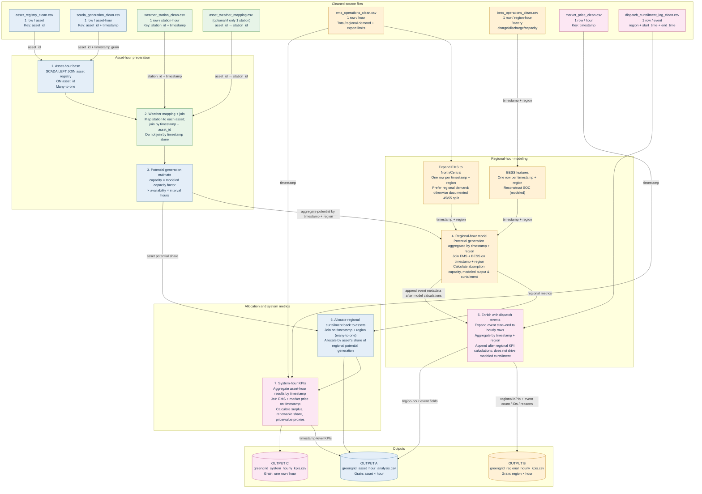

# GreenGrid Energy — Data Join & Operational KPI Pipeline

The pipeline builds an **asset-hour** fact table while preserving system-hour and region-hour grains for correct aggregation.

## Join rules and expected grain

| From | To | Join key / transformation | Join method and guardrail |
|---|---|---|---|
| SCADA | Asset registry | `asset_id` | `LEFT JOIN`; many SCADA rows per asset to one asset master row |
| Asset-hour base | Weather | `timestamp` + mapped `asset_id` (mapping contains `asset_id`, `station_id`) | Each asset must map to exactly one station in the script; weather itself is keyed by `station_id` + `timestamp` |
| Asset-hour potential generation | Regional model | Group by `timestamp`, `region` | Aggregate first; do not join raw asset rows directly to regional rows before aggregation |
| EMS | Regional model | Expand hourly EMS into North/Central rows; key `timestamp` + `region` | Prefer `north_demand_mwh` and `central_demand_mwh`; script falls back to 45%/55% if missing |
| BESS | Regional model | `timestamp` + `region` | One-to-one after checking the BESS grain is unique |
| Dispatch event log | Regional model / regional output | Expand `[start_time, end_time]` to hourly timestamps, then group by `timestamp` + `region` | Join the aggregated event-hour table, never the raw event log directly to asset-hour rows |
| Regional model | Asset-hour results | `timestamp` + `region` | Many asset-hour rows to one regional-hour row; curtailment allocated by potential-generation share |
| Asset-hour results | System KPI table | Group by `timestamp` | Aggregate to one row per hour before joining system inputs |
| EMS + market price | System KPI table | `timestamp` | One-to-one joins, after uniqueness checks |
| System KPI table | Asset-hour output | `timestamp` | Many asset-hour rows to one system-hour row; system KPIs repeat across assets in the same hour |

## Important interpretation note

`modeled_actual_generation_mwh`, `modeled_curtailment_mwh`, reconstructed battery SOC and market-value fields are model-based estimates. `market price × modeled curtailed MWh` is an indicative value proxy, not verified lost revenue or booked revenue. For total-system KPIs, use `greengrid_system_hourly_kpis.csv` to avoid summing repeated system values from the asset-hour output.
